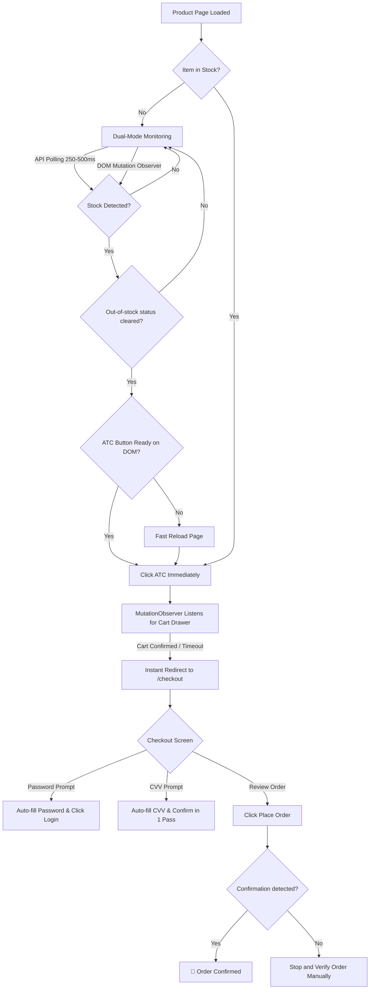

# Target Auto Buyer ⚡ v3.0

[](https://www.tampermonkey.net/)
[](https://www.target.com)
[](#features)
[](#license)

An ultra-fast, resilient userscript designed to automate product monitoring, carting, and checkout on **Target.com**. Specially engineered to win high-demand product drops (GPUs, game consoles, trading cards, limited-edition releases) where items sell out in seconds.

---

## ⚡ What Makes v3.0 Different?

Traditional bots poll every few seconds, reload entire pages when stock is spotted, and walk through checkout sequentially—wasting 12 to 20+ seconds.

**Target Auto Buyer v3.0** minimizes the critical path down to **2–5 seconds**:
- **Zero-Reload Stock Triggering:** The instant Target's backend API flags stock, the bot checks if the Add to Cart button is ready in the DOM without reloading the page—saving 2–5 seconds of HTML reflow.
- **MutationObserver Cart Drawer:** Listens to Target's DOM mutations to detect "Added to cart" drawers in milliseconds, eliminating polling lag.
- **Single-Pass Checkout Processing:** Fills credentials/CVV and clicks confirm buttons within the same 200ms cycle instead of waiting separate ticks.
- **Dual-Mode Stock Monitoring:** RedSky API polling + button attribute observer run simultaneously.
- **Adaptive Drop Countdown:** Set a target drop time; the bot maintains calm polling before switching to high-speed 250ms polling 30 seconds before release.

---

## 🚀 Key Features

### ⏱️ 1. Ultra-Low Latency & High-Speed Polling
- **⚡ Drop Mode:** Fixed 250ms polling interval for immediate item acquisition during hot drops.
- **Normal Polling Mode:** Configurable randomized intervals (500ms – 1500ms) for stealth monitoring.
- **Adaptive Timer:** Input the scheduled drop time (e.g., `10:00:00 AM`). The bot displays a live countdown and auto-activates Drop Mode 30 seconds before the drop.

### 🛒 2. Intelligent Add-to-Cart Flow
- **Direct Cart Drawer Detection:** Targets the live Target slide-out drawer (`Added to cart`, `View cart & check out`, `custom-quantity-picker`).
- **Auto-Decline Protection Plans:** Automatically dismisses warranty/protection plan modals without stalling the flow.
- **Cart Page Auto-Advance:** If routed through `/cart`, instantly clicks the Checkout button without hesitation.
- **ATC Retries:** Retries Add-to-Cart clicks up to 3 times before optimistically proceeding to checkout.

### 💳 3. Rapid Single-Pass Checkout
- **200ms Fast Execution Loop:** Continuously evaluates checkout state.
- **Credentials & CVV Auto-Fill:** Simulates native React inputs (`dispatchEvent`) for password, CVV, and mobile verification bypass.
- **Single Place Order Submission:** Clicks Place Order once to avoid duplicate submissions, then waits for an explicit confirmation signal.
- **Order Status Verification:** Reports success only when a recognized order-confirmation element or heading appears; otherwise asks you to verify the order manually.
- **Cart-Empty Error Recovery:** Detects if an item was claimed during checkout and returns gracefully to retry.

### 📊 4. Diagnostics & Live HUD
- **Real-Time Floating Control Panel:** Clean, draggable dashboard with Target red styling.
- **Live Performance Metrics:** Tracks timestamps and calculates latency for each stage:
  - `Stock → ATC`
  - `ATC → Cart Confirmed`
  - `Cart → Checkout Started`
  - `Total Time to Order Confirmation`
- **Pre-Warming Session Check:** Tests Target session cookies (`/co-cart`) on startup to ensure you're authenticated before the drop.

---

## 🛠️ Installation

### Step 1: Install a Userscript Manager
Install one of the following browser extensions on Chrome, Edge, Brave, or Firefox:
- [Tampermonkey](https://www.tampermonkey.net/) *(Recommended)*
- [Violentmonkey](https://violentmonkey.github.io/)

### Step 2: Install Target Auto Buyer
1. Open your userscript manager dashboard (click the extension icon in your browser toolbar).
2. Click **Create a new script** (`+` tab).
3. Delete any default template code.
4. Open [`Target Auto Buyer.js`](./Target%20Auto%20Buyer.js) and copy the entire contents.
5. Paste into the editor and press **Ctrl + S** (or **Cmd + S** on macOS) to save.
6. Verify the script is enabled in the Tampermonkey dashboard.

---

## 📖 How to Use

### 1. Pre-Drop Preparation (Crucial!)
To guarantee maximum checkout speed:
1. **Log in to your Target account** prior to the drop.
2. Ensure you have a **default shipping address** and **default payment card** saved in your Target wallet.
3. Make sure you know your card's **CVV**.

### 2. Configure the Bot HUD
Navigate to any Target product page (e.g. `https://www.target.com/p/...`). A floating red dashboard will appear in the bottom-right corner:

| Setting | Description | Recommended Setting |
|---|---|---|
| **CVV** | 3 or 4 digit security code for your saved card. | Your card's CVV |
| **Password** | Your Target account password (for re-auth prompts). | Your account password |
| **Max Price ($)** | Safety ceiling; bot won't purchase if price is higher. | Product MSRP + 10% |
| **Quantity** | Number of items to select (1–10). | `1` |
| **Drop Mode (⚡)** | Toggles ultra-aggressive 250ms polling. | Enabled during drops |
| **Drop Time** | Date & time when the item goes live. | Set to scheduled release time |

Click **Save Settings** to persist your preferences across page reloads.

Use the **Large / Compact** button in the dashboard header to resize the panel, or the **−** button to minimize it; these preferences are remembered. Drag the header to move the dashboard, and its position is saved. While monitoring, each stock-check attempt and its result appears in the dashboard log.

### 3. Launching the Bot
1. Navigate to the product page you want to monitor.
2. Click **Start Bot**. The status will turn green (`Running`).
3. If the item is out of stock, the bot will begin dual-mode monitoring (RedSky API + button observer). The observer will not click while the product page still reports “Out of Stock,” even if an ATC-like control is present.
4. Once the out-of-stock status clears and an enabled ATC control is available, the bot can add the item to cart and proceed through supported checkout prompts. It submits Place Order once, then reports success only after it detects an order-confirmation message. If checkout ends without a recognized confirmation, verify your Target account before trying again.

---

## 🔄 How It Works Under the Hood



---

## 🧪 Safe Testing & Dry Run Guide

Before relying on the bot for a live drop, test your setup safely:

1. **Test Stock & Carting:**
   - Go to any cheap in-stock item (e.g. a $1 household product).
   - Set **Max Price** to `$0.50`.
   - Start the bot. Notice that it correctly holds and monitors without purchasing because price exceeds the limit.
2. **Checkout Safety:**
   - Do not use a live Place Order submission as a dry run; an order may be accepted even if the page responds slowly.
   - For a safe test, verify the dashboard and checkout navigation, then stop the bot before submitting Place Order.
3. **Verify Drop Timer:**
   - Set the **Drop Time** to 1 minute in the future.
   - Watch the countdown tick down. Confirm that it turns yellow and switches to high-speed mode 30 seconds before 0:00.

---

## ⚙️ Advanced Configuration (Code Level)

All timing thresholds and constants are cleanly declared at the top of [`Target Auto Buyer.js`](./Target%20Auto%20Buyer.js):

```javascript
const CFG = {
    POLL_MIN_MS:             500,     // Normal min polling interval
    POLL_MAX_MS:            1500,     // Normal max polling interval
    DROP_MODE_POLL_MS:       250,     // Ultra-aggressive drop interval
    ADAPTIVE_LEAD_SEC:        30,     // Seconds before drop time to trigger drop mode
    API_MAX_RETRIES:           3,     // API retry attempts on 5xx errors
    API_RETRY_BASE_MS:       150,     // Backoff base for retries
    ATC_MAX_RETRIES:           3,     // Max ATC click attempts
    CART_CONFIRM_TIMEOUT_MS: 4000,    // Wait before optimistic checkout jump
    CHECKOUT_INTERVAL_MS:    200,     // Checkout cycle tick rate
    STARTUP_POLL_MS:         100,     // Fast startup poll interval
    STARTUP_MAX_WAIT_MS:    5000,     // Max wait for initial page elements
};
```

---

## ❓ Frequently Asked Questions

<details>
<summary><b>Does Target block or ban accounts for using this?</b></summary>
The script runs entirely inside your regular browser session using your authentic cookies, headers, and browser fingerprint. It behaves like an ultra-fast human user. However, running ultra-aggressive polling for hours continuously may trigger temporary rate limits or CAPTCHAs. Use Drop Mode specifically around drop windows.
</details>

<details>
<summary><b>What happens if a CAPTCHA appears?</b></summary>
If Target prompts for an Arkose Labs / FunCaptcha challenge, you must solve it manually in the browser window. Once solved, the bot automatically resumes its flow.
</details>

<details>
<summary><b>What if Target asks for SMS or email 2-step verification?</b></summary>
The script automatically clicks the "Skip" button if optional prompts appear. If a mandatory 2FA code is sent to your phone, enter the code manually; the bot continues immediately after you submit it.
</details>

<details>
<summary><b>Can I run multiple tabs?</b></summary>
Yes! The script uses isolated tab-level running states (`sessionStorage`), meaning each browser tab can monitor a different product independently without cross-tab conflicts.
</details>

---

## ⚠️ Disclaimer

This tool is created for educational and personal automation purposes only. The user is solely responsible for compliance with Target's Terms of Service. Automating purchases carries risks of unintended transactions—always verify prices and quantities before activating the bot on high-value products.

---

## 📄 License

This project is licensed under the [MIT License](https://opensource.org/licenses/MIT).