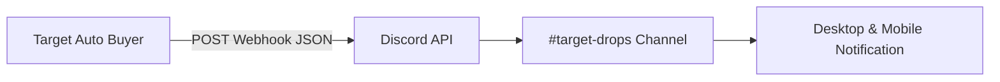
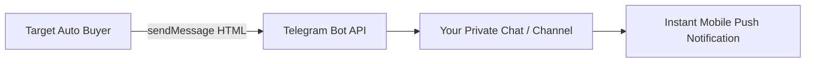
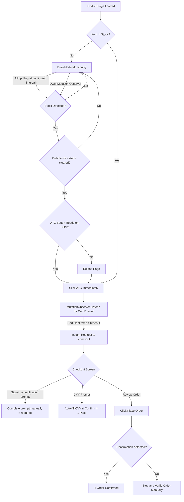

# Target Auto Buyer ⚡ v3.2

[](https://www.tampermonkey.net/)
[](https://www.target.com)
[](#features)
[](#license)

An experimental browser userscript for monitoring Target product availability and assisting with cart and checkout steps with instant Discord, Telegram, and audio chime alerts. It is not an official Target product and cannot guarantee stock, successful checkout, or an order.

---

## ⚡ Version 3.2 — What's New

Version 3.2 introduces multi-channel alerts and audio notifications:
- **💬 Discord Webhook Integration:** Rich embed alerts with product title, TCIN, price, quantity, status, and direct Target product links.
- **✈️ Telegram Bot Integration:** Instant messages via Telegram Bot API with formatted product and order details.
- **🔊 Built-In Web Audio Synthesizer:** Instant audio chimes for Stock Detected, Cart Added, Order Confirmed fanfare, and Warnings — zero external audio downloads or CORS issues.
- **🧪 One-Click Test Buttons:** Test your Discord webhook, Telegram connection, and Audio chimes directly from the bot control panel.
- **⚙️ Selective Event Triggers:** Toggle alerts for Stock Detection, Cart Confirmation, Order Submission/Confirmation, and Checkout Errors individually.

---

## 🚀 Key Features

### 🔔 1. Multi-Channel Alerts & Audio Chimes (New in v3.2)
- **Discord Webhooks:** Sends rich colored embeds on in-stock detection, add-to-cart confirmation, and order completion.
- **Telegram Bot API:** Instant push alerts to your Telegram chat or channel.
- **Web Audio API Chimes:**
  - 🚨 *In-Stock Alert:* Energetic ascending arpeggio.
  - 🛒 *Cart Added:* Upbeat double confirmation chime.
  - 🎉 *Order Confirmed:* Full celebratory victory fanfare!
  - ⚠️ *Errors / Alerts:* Warning alert tones.
- **In-Panel Testing:** "Test" buttons let you verify webhook deliveries and sound playback immediately before drop time.

### ⏱️ 2. Ultra-Low Latency & High-Speed Polling
- **⚡ Drop Mode:** Uses a 250ms API polling interval while enabled.
- **Normal Polling Mode:** Uses a randomized interval between the configured minimum and maximum.
- **Drop Timer:** Displays a countdown and uses 250ms polling during the configured 30 seconds before the drop time.
- **Polling limits:** Rapid repeated requests may be rate-limited or blocked. Use monitoring only when needed.

### 🛒 3. Intelligent Add-to-Cart Flow
- **Direct Cart Drawer Detection:** Targets the live Target slide-out drawer (`Added to cart`, `View cart & check out`, `custom-quantity-picker`).
- **Auto-Decline Protection Plans:** Automatically dismisses warranty/protection plan modals without stalling the flow.
- **Cart Page Auto-Advance:** Looks for a supported checkout button on the cart page.
- **ATC Retries:** Retries when cart confirmation is not detected; after the retry limit it may continue to checkout without confirmed cart status. Verify the cart contents yourself.

### 💳 4. Rapid Single-Pass Checkout
- **200ms Fast Execution Loop:** Continuously evaluates checkout state.
- **CVV Auto-Fill:** Fills the CVV field when configured. Login, mandatory verification, CAPTCHA, and other prompts may require manual action.
- **Single Place Order Submission:** Clicks Place Order once per loaded checkout page, then waits for an explicit confirmation signal. A page reload starts a new script page session, so the bot cannot guarantee duplicate prevention across reloads.
- **Best-Effort Order Status:** Looks for specific confirmation elements/headings while the checkout handler is running. If checkout ends without detecting one, it asks you to verify the order manually. Confirmation detection may fail if Target changes its page or navigation.
- **Cart Error Detection:** Detects some item-removed and sold-out messages. It does not guarantee recovery or a successful retry.

### 📊 5. Diagnostics & Live HUD
- **Real-Time Floating Control Panel:** Drag the header to move the dashboard; use Large/Compact and minimize/restore controls. Its position and size preferences are saved.
- **Collapsible Alerts Section:** Expand/collapse the notifications drawer to configure webhooks, tokens, and sound toggles.
- **Live Stock Log:** Displays each API stock-check attempt and its result; keeps the most recent 300 log lines.
- **Live Performance Metrics:** Tracks timestamps and calculates latency for each stage:
  - `Stock → ATC`
  - `ATC → Cart Confirmed`
  - `Cart → Checkout Started`
  - `Total Time to Order Confirmation` when confirmation is detected
- **Session Check:** Checks the `/co-cart` endpoint before starting. This does not guarantee that your session is authenticated or that checkout will succeed.

---

## 🛠️ Installation

### Step 1: Install a Userscript Manager
Install one of the following browser extensions on Chrome, Edge, Brave, or Firefox:
- [Tampermonkey](https://www.tampermonkey.net/) *(Recommended)*
- [Violentmonkey](https://violentmonkey.github.io/)

### Step 2: Install Target Auto Buyer
1. Open your userscript manager dashboard (click the extension icon in your browser toolbar).
2. Click **Create a new script** (`+` tab).
3. Delete any default template code.
4. Open [`Target Auto Buyer.js`](./Target%20Auto%20Buyer.js) and copy the entire contents.
5. Paste into the editor and press **Ctrl + S** (or **Cmd + S** on macOS) to save.
6. Verify the script is enabled in the Tampermonkey dashboard.

---

## 📖 How to Use

### 1. Pre-Drop Preparation (Crucial!)
Before running the bot:
1. **Log in to your Target account** prior to the drop.
2. Ensure you have a **default shipping address** and **default payment card** saved in your Target wallet.
3. Make sure you know your card's **CVV**.

### 2. Configure the Bot HUD
Navigate to any Target product page (e.g. `https://www.target.com/p/...`). A floating red dashboard will appear in the bottom-right corner:

| Setting | Description | Recommended Setting |
|---|---|---|
| **CVV** | 3 or 4 digit security code for your saved card. | Your card's CVV |
| **Max Price ($)** | Attempts to hold when the product page price is above the entered amount. **This is not a reliable purchase limit; do not rely on it as a safety control.** | Set a value, but verify price yourself |
| **Quantity** | Number of items to select (1–10). | `1` |
| **Drop Mode (⚡)** | Toggles 250ms API polling. | Enable only when needed |
| **Drop Time** | Date & time when the item goes live. | Set to scheduled release time |
| **Audio Alerts (🔊)** | Synthesizes pleasant attention chimes for stock, cart, order, and errors. | Enabled |
| **Discord Webhook (💬)** | Webhook URL for posting embeds to your private Discord channel. | Optional |
| **Telegram Bot (✈️)** | Telegram Bot Token and Chat ID for instant Telegram notifications. | Optional |
| **Event Preferences** | Selectively toggle Stock, Cart, Order, and Error notifications. | All Checked |

Settings are saved as they are changed via the userscript manager.

### 3. Setting Up Alerts & Notifications (Discord, Telegram & Sound)

Click **🔔 Alerts & Notifications** on the bot dashboard to expand the alerts configuration drawer. Target Auto Buyer v3.2 supports both Discord and Telegram, treating them as distinct notification systems formatted specifically for each platform's design guidelines.

---

#### 💬 How to Connect Discord Webhooks

Discord webhooks allow Target Auto Buyer to push rich, colored visual **Embeds** directly into any text channel in your private Discord server.



##### Step 1: Create a Discord Webhook
1. Open Discord on desktop or in your browser.
2. Navigate to your server (or create a new free private server for drop alerts).
3. Right-click the channel you want alerts in (e.g. `#target-drops`) and select **Edit Channel** (⚙️).
   *(Alternatively, go to **Server Settings** → **Integrations** → **Webhooks**).*
4. Click **Integrations** in the left sidebar, then click **Webhooks** → **New Webhook**.
5. Give your webhook a friendly name (e.g., `Target Auto Buyer`) and select your desired channel.
6. Click **Copy Webhook URL**. The URL looks like:
   `https://discord.com/api/webhooks/123456789012345678/abcdefghijklmnopqrstuvwxyz...`

##### Step 2: Configure in Target Auto Buyer HUD
1. On any Target page, expand the **🔔 Alerts & Notifications** section.
2. Click the toggle switch next to **💬 Discord Webhook** to turn it **ON** (green).
3. Paste your copied Webhook URL into the input field.
4. Click **Test Discord Webhook**. You will instantly receive a test embed in Discord!

##### 🎨 Discord Notification Template Architecture
Discord alerts utilize Discord's native Embed API:
- **Color Coding:** Green (`#22C55E`) for in-stock, Blue (`#3B82F6`) for cart, Amber (`#F59E0B`) for checkout submission, Emerald (`#10B981`) for order confirmation, and Red (`#EF4444`) for errors.
- **Inline Multi-Column Grid:** Displays TCIN, Price, Quantity, and Timing Latency side-by-side in responsive field columns.
- **Product Title Link:** Clickable hyperlink leading directly to the Target product page.
- **Thumbnail:** Target branding thumbnail attached to the card.
- **Localized Timestamp:** Discord displays the exact time converted to your device's local timezone.

---

#### ✈️ How to Connect Telegram Bot API

Telegram uses the official Bot API to send instantaneous push notifications to your personal direct messages, private group, or announcement channel.



##### Step 1: Create Your Bot with BotFather
1. Open the Telegram app and search for `@BotFather` (ensure it has the official blue verification checkmark).
2. Start the chat and send:
   ```text
   /newbot
   ```
3. Enter a friendly name for your bot (e.g. `Target Drop Alerts`).
4. Enter a username for your bot that ends with `bot` (e.g. `target_buyer_alert_bot`).
5. BotFather will provide an **HTTP API Token**. Copy it. It looks like:
   `7123456789:AAFlkJ389asdf89asdf23jkl_asdf`

##### Step 2: Start a Conversation with Your Bot
- Click the link provided by BotFather (e.g. `t.me/target_buyer_alert_bot`) and click **Start** (or send `/start`).
- *Note:* Telegram bots cannot message you first; you must click Start once so the bot has permission to send you messages.

##### Step 3: Find Your Telegram Chat ID
You can receive alerts in your personal private chat, in a private group, or in a channel:

- **Option A — Personal Chat (Most Common):**
  1. Search for `@userinfobot` or `@RawDataBot` in Telegram.
  2. Send it any message.
  3. It will reply with your numerical **Id** (e.g., `123456789`).

- **Option B — Private Group or Channel:**
  1. Add your bot as an **Administrator** in your group or channel (grant "Post Messages" permission).
  2. For a public channel, your Chat ID is `@yourchannelusername` (e.g., `@target_drops_feed`).
  3. For a private channel or group, forward a message from the channel to `@RawDataBot` to find the negative channel ID (e.g., `-100192837465`).

##### Step 4: Configure in Target Auto Buyer HUD
1. In the bot dashboard, expand **🔔 Alerts & Notifications**.
2. Click the toggle switch next to **✈️ Telegram Bot** to turn it **ON** (green).
3. Paste your **Bot Token** into the Token field.
4. Paste your **Chat ID** into the Chat ID field.
5. Click **Test Telegram Message**. Your bot will immediately deliver a formatted test alert!

##### 📱 Telegram Notification Template Architecture
Telegram does not use embeds; instead, it uses clean, structured **HTML messages** optimized for mobile reading:
- **Header Emoji & Bold Status:** `🚨 TARGET ITEM IN-STOCK!` or `🎉 ORDER CONFIRMED!`
- **Clean Visual Dividers:** Clean divider bars (`━━━━━━━━━━━━━━━━━━━━`) separating sections.
- **Monospaced Code Badges:** Price `<code>$499.99</code>`, TCIN `<code>88492049</code>`, and latency metrics formatted in copyable monospaced tags.
- **Call-to-Action Link:** `👉 View on Target.com` formatted as a prominent hyperlink.
- **Rich Card Preview:** Target product card preview automatically generated by Telegram.

---

#### 🔊 Built-in Web Audio Chimes
- **Instant Zero-Latency Feedback:** Generated using the browser's native Web Audio API (`AudioContext`). No audio files to download, no 404 errors, no CORS restrictions.
- **Tone Profiles:**
  - 🚨 **Stock Detected:** High-energy ascending arpeggio (C5 → E5 → G5 → C6).
  - 🛒 **Cart Confirmed:** Positive double confirmation chime (G5 → C6).
  - 🎉 **Order Confirmed:** Celebratory victory fanfare arpeggio!
  - ⚠️ **Checkout Warning / Sold Out:** Low-pitch double alert tone.
- **Testing:** Click the **Test** button next to Audio Alerts to sample the chime and ensure your browser's audio output is active.

---

### 4. Platform Notification Comparison

| Feature | 💬 Discord Webhooks | ✈️ Telegram Bot API | 🔊 Web Audio Chimes |
|---|---|---|---|
| **Notification Type** | Visual Rich Embed Cards | Formatted HTML Text Block | Synthesized Audio Frequencies |
| **Delivery Medium** | Discord Channel / Server | Direct Message, Group, or Channel | Local Browser Audio Speakers/Headphones |
| **Color Coding** | Colored side-strip per event status | Visual Emoji Status Headers | Tone Frequency Modulation |
| **Data Formatting** | Responsive multi-column grid fields | Code blocks (`<code>`) & bold highlights | Pitch & tempo changes |
| **Product Links** | Hyperlinked embed title | Styled HTML anchor (`<a>`) | None |
| **External Setup** | Server Webhook URL | BotFather Token + Chat ID | None (Ready out of the box) |
| **Offline Push** | Discord Mobile/Desktop app | Telegram Mobile/Desktop app | Works while tab is open |

---

### 5. Launching the Bot
1. Navigate to the product page you want to monitor.
2. Click **Start Bot**. The status will turn green (`Running`).
3. If the item is out of stock, the bot will begin dual-mode monitoring (RedSky API + button observer). The observer will not click while the product page still reports “Out of Stock,” even if an ATC-like control is present.
4. Once the out-of-stock status clears and an enabled ATC control is available, the bot may attempt to add the item to cart and proceed through supported checkout prompts.
5. The bot submits Place Order at most once while the current checkout page remains loaded. It may show **Awaiting Confirmation**. If a recognized confirmation appears while its checkout handler is active, it reports **Order Confirmed**; if checkout ends without one, verify your Target account and email before taking any further action. Never click Place Order again just because the bot status is uncertain. A page reload starts a new script page session, so duplicate prevention is not guaranteed across reloads.

**Important:** The Max Price setting is not a guaranteed purchase cap. The stock-monitoring flow may still attempt to add an item when the page price is above the configured amount. Do not leave the bot unattended or rely on the price setting to prevent an unwanted purchase. Verify the item, price, quantity, shipping, and payment details before any order submission.

---

## 🔄 How It Works Under the Hood



---

## 🧪 Safe Testing Guide

Test the interface without placing an order:

1. Open a product page and check that the dashboard appears.
2. Test the Large/Compact, minimize/restore, and drag controls.
3. Set a future Drop Time and confirm the countdown updates.
4. If testing cart or checkout navigation, stop the bot before Place Order. Do not use an incorrect CVV as a dry run; a real order may still be accepted or the result may be ambiguous.
5. Treat Max Price as informational only, not as protection against an unintended purchase.

---

## ⚙️ Advanced Configuration (Code Level)

All timing thresholds and constants are cleanly declared at the top of [`Target Auto Buyer.js`](./Target%20Auto%20Buyer.js):

```javascript
const CFG = {
    POLL_MIN_MS:             500,     // Normal min polling interval
    POLL_MAX_MS:            1500,     // Normal max polling interval
    DROP_MODE_POLL_MS:       250,     // Ultra-aggressive drop interval
    ADAPTIVE_LEAD_SEC:        30,     // Seconds before drop time to trigger drop mode
    API_MAX_RETRIES:           3,     // API retries on server/network errors
    API_RETRY_BASE_MS:       150,     // Backoff base for retries
    ATC_MAX_RETRIES:           3,     // Max ATC click attempts
    CART_CONFIRM_TIMEOUT_MS: 4000,    // Wait before optimistic checkout jump
    CHECKOUT_INTERVAL_MS:    200,     // Checkout cycle tick rate
    STARTUP_POLL_MS:         100,     // Fast startup poll interval
    STARTUP_MAX_WAIT_MS:    5000,     // Max wait for initial page elements
};
```

---

## ❓ Frequently Asked Questions

<details>
<summary><b>Could monitoring be rate-limited?</b></summary>
Yes. Frequent requests may be limited or blocked, and Target may present additional verification. Use the bot only when needed and follow Target's applicable terms.
</details>

<details>
<summary><b>What happens if a CAPTCHA or verification prompt appears?</b></summary>
The bot does not solve CAPTCHAs or mandatory verification challenges. Complete any supported prompt manually and check the page before continuing.
</details>

<details>
<summary><b>Does an order-confirmed status guarantee a successful purchase?</b></summary>
No. Detection depends on the current Target page structure and can fail or misidentify a page. Verify orders in your Target account and confirmation email.
</details>

<details>
<summary><b>Can I run multiple tabs?</b></summary>
Yes! The script uses isolated tab-level running states (`sessionStorage`), meaning each browser tab can monitor a different product independently without cross-tab conflicts.
</details>

---

## ⚠️ Disclaimer

This tool is experimental, is not affiliated with Target, and is provided without guarantees. Automated purchasing may be restricted by Target's terms. You are responsible for reviewing and confirming all order details. Do not rely on this script for price protection, purchase confirmation, or unattended ordering.

---

## 📄 License

This project is licensed under the [MIT License](https://opensource.org/licenses/MIT).